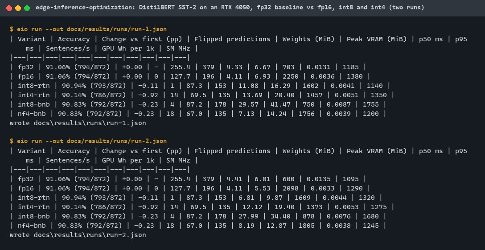
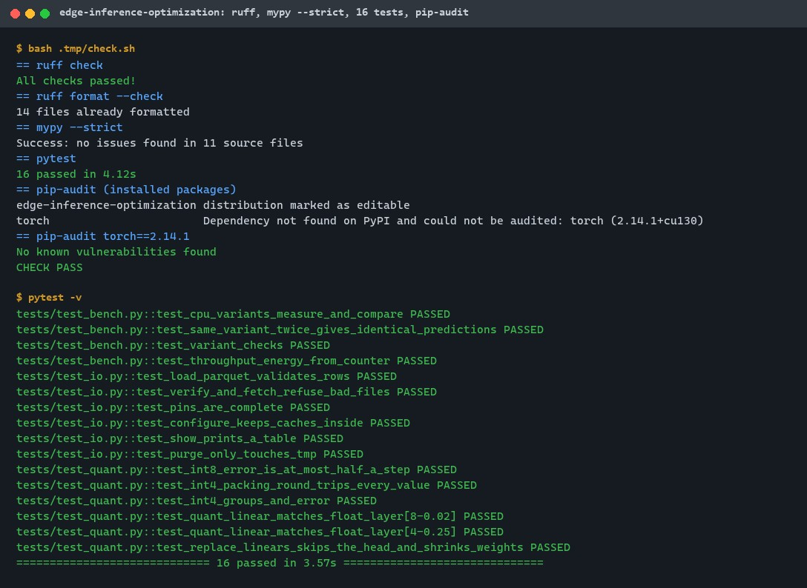
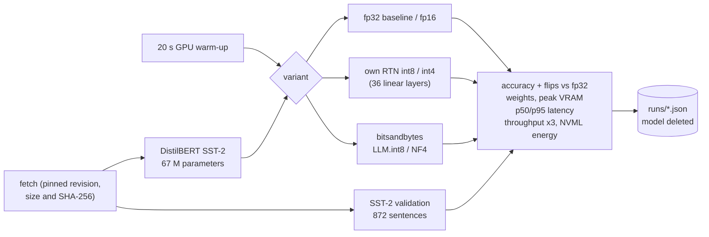
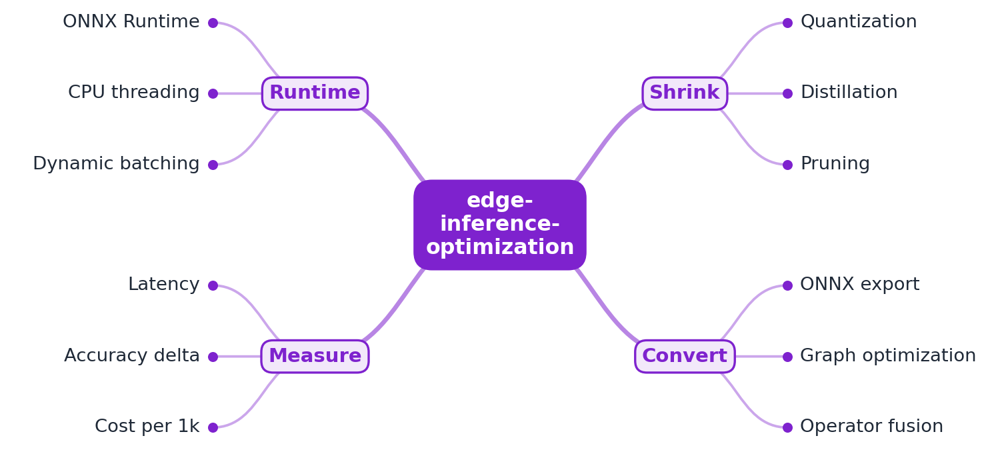

# edge-inference-optimization

[](https://github.com/EquinoxWN/edge-inference-optimization/actions/workflows/ci.yml)


> What shrinking a model really costs: DistilBERT quantized to fp16, int8 and int4 on a laptop GPU, measured for accuracy, flipped predictions, memory, speed and energy.

Part of my **AI and Machine Learning** list · Python

## Proof it works

A DistilBERT sentiment classifier runs in plain PyTorch on a 6 GB laptop GPU as the fp32
baseline (91.06% on the 872 held-out SST-2 sentences), then as fp16, int8 and int4. fp16 changes
no prediction; int8 changes 1 (round-to-nearest) or 4 (LLM.int8); int4 costs 0.92 points
(round-to-nearest) or 0.23 points (NF4). Two runs, same accuracy, throughput within 17%:



16 tests pass, ruff and mypy --strict are clean, and pip-audit finds no known vulnerabilities:



## Architecture

**What M1 runs today:**



**Full roadmap (M1 to M3):**



## How it works

_Steps 1 and 2 are built and tested (M1); the rest is on the [roadmap](#roadmap)._

1. A baseline model is served in plain PyTorch on GPU to set the reference for accuracy, latency and cost.
2. The model is quantized to int8 and int4, and the accuracy lost at each step is measured on a held-out set.
3. A smaller student model is distilled from the original, trading a little accuracy for a large speed-up.
4. The model is exported to ONNX, and graph optimization plus operator fusion streamline it for CPU.
5. ONNX Runtime serves it on commodity CPUs with tuned threading and dynamic batching; llama.cpp is compared for LLMs.
6. A cost model turns latency and hardware price into cost per 1,000 requests, showing the CPU-vs-GPU trade-off.

In M1 every variant is loaded from the same pinned weights, run over the whole held-out set,
compared prediction by prediction with the fp32 baseline, then timed one request at a time
(tokenize, forward, argmax) and in batches of 32, with the GPU's energy counter read around the
batched rounds. The model and data are deleted when the run ends.

## Who it helps

- **Who:** ML and platform engineers deciding how to serve a model more cheaply, and people learning
  what quantization actually costs.
- **The problem:** quantization is usually adopted on the assumption that "int8 loses nothing";
  speed numbers on shared GPUs are noisy; and accuracy alone hides how many individual answers changed.
- **What M1 does:** one command measures six formats of the same model on the same held-out set:
  accuracy, flipped predictions, weight memory, peak VRAM, p50/p95 latency, throughput and GPU
  energy per 1,000 requests, with the GPU warmed up and three throughput rounds per variant.
- **How to use it:** `make setup-gpu && make run`, then read `docs/results/m1-run.json`. To measure
  your own classifier, change the pinned model and data in `sources.py`; the quantizer
  (`quant.replace_linears`) works on any model built from `nn.Linear` layers.

## Tech stack

| Area | In M1 | Planned |
|---|---|---|
| Model | DistilBERT fine-tuned on SST-2, PyTorch 2.14 (CUDA 13.0), transformers 5 | Distilled student (M2) |
| Quantization | Own round-to-nearest int8 (per channel) and int4 (groups of 32, packed); bitsandbytes LLM.int8 and NF4 | ONNX graph optimization (M2) |
| Measurement | Accuracy, flips, weight bytes, peak VRAM, p50/p95 latency, median-of-3 throughput, NVML energy, SM clock | ONNX Runtime on CPUs, llama.cpp (M3) |
| Cost | GPU Wh per 1,000 requests | Dollars per 1,000 requests from hardware prices (M3) |
| Quality | ruff, mypy --strict, 16 tests (CPU, tiny model), pip-audit, CI | |

Language: **Python 3.11+** (3.12 in CI, 3.14 locally).

| Path | What it is |
|---|---|
| `src/edge_inference_optimization/quant.py` | RTN int8 and int4 formats, `QuantLinear`, layer replacement |
| `src/edge_inference_optimization/bench.py` | Variants, accuracy, latency, throughput, energy, warm-up |
| `src/edge_inference_optimization/sources.py` | Pinned model and data downloads |
| `src/edge_inference_optimization/data.py` | Held-out set loader with schema checks |
| `src/edge_inference_optimization/cli.py` | `eio prepare`, `run`, `show`, `purge` |
| `src/edge_inference_optimization/env.py` | Keeps caches in `.tmp`, offline and no telemetry |
| `docs/results/runs/` | Every recorded run as JSON |

## Run it

Needs Python 3.11+ and make; the GPU run needs an NVIDIA GPU with a CUDA 13 driver. Downloads,
caches and the model stay in git-ignored `.tmp/`; use a virtual environment.

```bash
python -m venv .venv && . .venv/Scripts/activate   # Linux/macOS: .venv/bin/activate
make setup       # CPU torch + dev tools (what CI uses)
make lint        # ruff, ruff format --check, mypy --strict
make test        # 16 tests on a tiny random model, no download
make audit       # pip-audit
make setup-gpu   # CUDA torch, bitsandbytes, accelerate, nvidia-ml-py
make run         # all variants on the GPU, about 3 minutes; deletes the model afterwards
make show        # print docs/results/m1-run.json as a table
```

`eio run --variants fp32 int8-rtn --limit 200 --no-speed` runs a subset; `--cpu` forces the CPU
(fp32 and RTN variants only); `--keep-model` skips the deletion.

## Tests and results

Latest local run (full detail in [docs/results/m1.md](docs/results/m1.md)):

| Test file | Tests | What it proves |
|---|---|---|
| `tests/test_quant.py` | 6 | int8 and int4 error bounds, exact int4 packing, per-group scales, layer outputs close to float, head kept, weights shrink |
| `tests/test_bench.py` | 4 | Variants end to end on a tiny model, deterministic predictions, GPU-only variants refused on CPU, energy arithmetic |
| `tests/test_io.py` | 6 | Data schema checks, hash and HTTPS enforcement, cache containment, results table, purge limited to `.tmp` |

| Variant | Accuracy | vs fp32 | Flipped | Weights | Sentences/s (run 1 / 2) | GPU Wh per 1k (run 1 / 2) |
|---|---|---|---|---|---|---|
| fp32 (baseline) | 91.06% | 0.00 | - | 255.4 MiB | 703 / 600 | 0.0131 / 0.0135 |
| fp16 | 91.06% | 0.00 | 0 | 127.7 MiB | 2,250 / 2,098 | 0.0036 / 0.0033 |
| int8 RTN | 90.94% | -0.11 | 1 | 87.3 MiB | 1,602 / 1,609 | 0.0041 / 0.0044 |
| int4 RTN | 90.14% | -0.92 | 14 | 69.5 MiB | 1,457 / 1,373 | 0.0051 / 0.0053 |
| LLM.int8 | 90.83% | -0.23 | 4 | 87.2 MiB | 750 / 878 | 0.0087 / 0.0076 |
| NF4 | 90.83% | -0.23 | 18 | 67.0 MiB | 1,756 / 1,805 | 0.0039 / 0.0038 |

| Check | Result |
|---|---|
| Tests | 16 passed, 0 failed |
| Lint and types | ruff, ruff format, mypy --strict: clean |
| Audit | pip-audit: no known vulnerabilities (torch 2.14.1 audited separately: none) |
| Repeatability | accuracy identical in four runs; throughput within 17% between the two final runs (up to 4.6x before the warm-up fix) |

Weights include about 46 MiB of float16 embeddings and head that are not quantized. The RTN
variants dequantize weights in every call, so their speed shows that code, not int8 or int4
hardware. Energy includes the GPU's idle draw. CI runs lint, the tests on CPU and the audit; the
GPU numbers are local only.

## Roadmap

**M1** (≈8 h)
- [x] Write `docs/rfc/0001-design.md`: problem, goals, non-goals, chosen design
- [x] A baseline model is served in plain PyTorch on GPU to set the reference for accuracy, latency and cost.
- [x] The model is quantized to int8 and int4, and the accuracy lost at each step is measured on a held-out set.

**M2** (≈8 h)
- [ ] A smaller student model is distilled from the original, trading a little accuracy for a large speed-up.
- [ ] The model is exported to ONNX, and graph optimization plus operator fusion streamline it for CPU.

**M3** (≈9 h)
- [ ] ONNX Runtime serves it on commodity CPUs with tuned threading and dynamic batching; llama.cpp is compared for LLMs.
- [ ] A cost model turns latency and hardware price into cost per 1,000 requests, showing the CPU-vs-GPU trade-off.
- [ ] Publish the proof below with real numbers

## Proof

What this repo must show before it counts as done:

- A cost-vs-accuracy table: GPU baseline vs quantized and distilled CPU versions, with dollars per 1k requests.

| Result | Value |
|---|---|
| GPU baseline vs quantized (M1) | See [Tests and results](#tests-and-results): accuracy, flips, memory, speed and GPU energy per 1k requests |
| Distilled and CPU versions, dollars per 1k requests | Not built yet (M2, M3) |

## Why it matters

- **Interview angle:** 'Serve this model at a tenth of the cost': deployment and quantization trade-offs.
- **Upstream I'd like to contribute to:** ONNX Runtime or Hugging Face Optimum: examples and docs.

## Design docs

- [RFC 0001: design](docs/rfc/0001-design.md)
- [ADR 0001: record architecture decisions](docs/adr/0001-record-architecture-decisions.md)
- [ADR 0002: measure an own round-to-nearest quantizer next to bitsandbytes](docs/adr/0002-own-rtn-quantizer-and-bitsandbytes.md)
- [M1 results](docs/results/m1.md)

## Scope

This is a learning and portfolio system, not a hosted production service. Everything runs locally.

## Security and contributing

- The model and data are pinned by revision, size and SHA-256 and fetched over HTTPS only; a file
  that fails its check is deleted; weights are read from safetensors.
- Every cache is kept in `.tmp`, Hugging Face runs offline with telemetry off, and the model is
  deleted after each run.
- Every GitHub Action is pinned to a commit SHA; workflows run read-only, without persisted credentials.
- Dependabot update pull requests are paused (`open-pull-requests-limit: 0`) so the repository keeps a single `main` branch; dependencies are updated by hand and checked by the CI audit.
- ruff, mypy --strict and the tests on every push; pip-audit (`make audit`) in CI.
- Report vulnerabilities privately: see [SECURITY.md](SECURITY.md). To contribute, see [CONTRIBUTING.md](CONTRIBUTING.md).

## License

MIT, see [LICENSE](LICENSE).
